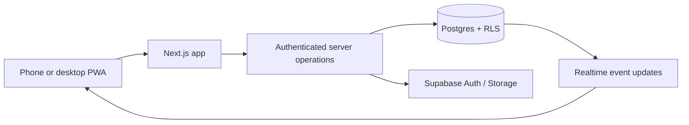

# TRD — Technical Requirements Document
Version 0.1 | Status: Proposed architecture, not final infrastructure procurement

## Architecture
Frontend/PWA: Next.js App Router + React + TypeScript + Tailwind + shadcn/ui. Auth/data: Supabase Auth + Postgres with Row Level Security + Storage + optionally Realtime. Hosting: Vercel or equivalent compatible platform. Localization: next-intl, routes `/pt-BR/...` and `/en/...`. Tests: Vitest + Playwright; schema migration and CI required.

## Technical invariants
- Tenant boundary: every relevant domain row belongs to `club_id` and all reads/mutations validate active membership of the *same* club.
- Team boundary: a coach needs a matching team assignment, not merely a club coach role.
- All privileged writes verified on server/database; authorization must not depend on client UI.
- Event times persisted as UTC `timestamptz`; render with club's IANA timezone; retain language separately from timezone.
- DB uniquely prevents duplicate active user/event RSVP and team member relationships.
- Capacity and waitlist promotion happen in one atomic database transaction or trusted Postgres function, not in client event handlers.
- Audit admin actions; redact personal data and tokens from logs.
- Data access works for second club with test fixtures before public launch.

## Main modules
`auth`, `clubs`, `memberships`, `teams`, `team-members`, `invites`, `events`, `rsvps`, `attendance`, `notifications`, `localization`, `audit`.

## Client states
Auth required; loading; empty; ready; validation error; unauthorized; network unavailable; optimistic pending; confirmed; synchronized conflict. Never display a success state until the server confirms a transaction.

## PWA design
Manifest, icons (192/512), HTTPS, service worker, install guidance, offline fallback/shell. Cache non-sensitive static assets preferentially; avoid persisting club roster/PII in shared browser caches. RSVP/attendance require network in v1; show explicit connectivity state rather than queued success.

## Requirements
- Performance SLO: primary screens <2 seconds on agreed 4G test profile; collect real metrics.
- Accessibility: WCAG 2.2 AA targeted and manual keyboard/screen reader testing.
- 99.5% proposed availability, backup retention 7 days (verify plan/restore capabilities and restore drills).
- Monitoring: errors, latency, permission-denied rates, RSVP waitlist conflicts, invite failures; without logging email addresses or invite tokens.
- Keep secrets server-side; never put service-role keys into client bundle.

## Hosting and residency warning
A Supabase project has one primary selected region. One database project cannot simultaneously give local primary residency in EU, UK and Brazil. Launch in a **specific EU region (proposed Ireland)** for IVI and create a region-by-region architecture/transfer and vendor review before UK/Brazil rollout. Compliance with GDPR/UK GDPR/LGPD is not created merely by choosing a server region. Confirm processor locations, logs, backups, subprocessors, DPA and lawful transfer safeguards.

## Decisions to document as ADRs
ADR-001 Hosting and region; ADR-002 Auth and roles; ADR-003 Club isolation model; ADR-004 RSVP transaction algorithm; ADR-005 PWA caching; ADR-006 localization policy; ADR-007 audit/retention; ADR-008 Brazil and UK expansion strategy.

## Official references
- https://nextjs.org/docs/app/guides/progressive-web-apps
- https://nextjs.org/docs/app/guides/internationalization
- https://supabase.com/docs/guides/platform/regions
- https://supabase.com/legal/privacy-resources/data-residency-and-transfers-faq