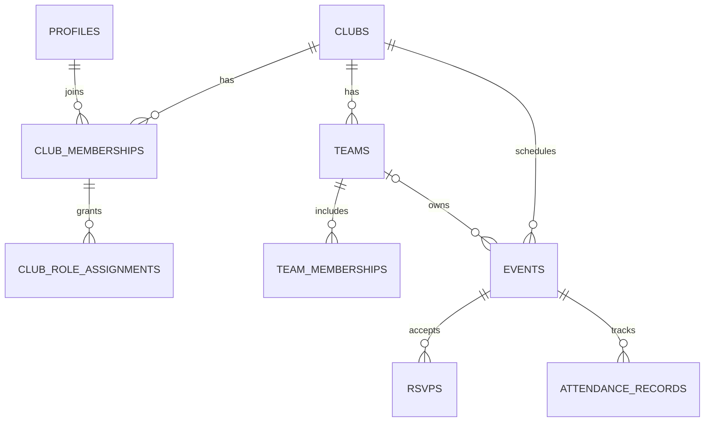

# BACKEND — Data Model, Permissions, APIs
Version 0.1 | Proposed; migration SQL to be generated after approval

## Data entities
| Table | Essential columns | Notes |
| --- | --- | --- |
| profiles | user_id PK, display_name, locale, created_at, deleted_at | Linked to auth user |
| clubs | id PK, name, logo_path, timezone, data_region, created_by, deleted_at | `data_region` declarative, not proof of physical storage |
| club_memberships | id, club_id FK, user_id FK, status, joined_at | Unique `(club_id, user_id)` active membership |
| club_role_assignments | id, membership_id FK, role | `admin`, `coach`, `player` roles can coexist |
| teams | id, club_id FK, name, division, gender_category, season, archived_at | Do not hard-code only Div 2/3/4 for all future clubs |
| team_memberships | id, club_id, team_id, user_id, membership_type, status | `player` and `coach` team associations; FKs ensure same club |
| invites | id, club_id, token_hash, expires_at, revoked_at, max_uses, used_count | Never store reusable plaintext token in logs |
| join_requests | id, club_id, user_id, status, reviewed_by, reviewed_at | Pending/approved/declined |
| events | id, club_id, team_id nullable, type, title, starts_at, ends_at, venue_text, map_url, capacity, rsvp_deadline, status | `team_id=NULL` can represent club-wide |
| rsvps | id, club_id, event_id, user_id, status, waitlist_position, updated_at | Unique `(event_id,user_id)`; no client-supplied queue rank |
| attendance_records | id, club_id, event_id, user_id, status, marked_by, marked_at | Unique `(event_id,user_id)` |
| notifications | id, club_id, recipient_user_id, kind, event_id, read_at, created_at | Permission-scoped |
| audit_events | id, club_id, actor_user_id, action, entity_type, entity_id, happened_at, safe_metadata | Sensitive actions only; no token/PII payload |

All tenant-owned tables use `club_id` where appropriate; enforce cross-table `club_id` consistency with constraints/triggers and validate reference ownership (e.g., event team and team member must belong to same club).

## Relationship outline

## RLS / access policy
1. Activate RLS on every exposed table; default deny.
2. User may select their own profile and membership; member-visible team/club data requires active matching club membership.
3. Club admin can create teams, assign roles, approve requests and manage any club event.
4. Coach edits events/attendance only where assigned to same team, unless explicit admin rights.
5. Player can write only own eligible RSVP, not another member's attendance or roles.
6. Use security-definer RPC functions sparingly and securely (fixed search_path, role checks, no user-controlled authorization identifiers without verification).
7. Multi-tenant tests include malicious `club_id` and `team_id` mismatches, removed membership, guessed UUID, revoked invite.

## API / RPC contract proposals
| Operation | Endpoint / RPC | Authorizer |
| --- | --- | --- |
| Create club | `POST /api/clubs` | authenticated user |
| Create team | `POST /api/clubs/{clubId}/teams` | club admin |
| Invite member | `POST /api/clubs/{clubId}/invites` | club admin |
| Review join request | `POST /api/clubs/{clubId}/join-requests/{id}/decision` | club admin |
| Create event | `POST /api/clubs/{clubId}/events` | admin or assigned team coach |
| Event listing | `GET /api/clubs/{clubId}/events` | scoped active member |
| RSVP action | `POST /api/events/{eventId}/rsvp` -> transactional function | authorized event participant |
| Attendance batch | `PUT /api/events/{eventId}/attendance` | admin or assigned team coach |

API is illustrative, not a promise that all endpoints must be REST rather than server actions. Document request/response schemas, error codes, pagination, retry semantics and rate limiting before implementation.

## RSVP atomic algorithm
Within one Postgres transaction: lock the event or use an equivalent concurrency strategy; verify event scheduled, user eligible, cutoff, and membership; count valid `going`; update user's single RSVP; if no slot then waitlist with stable sequence; if a going slot was freed, promote earliest eligible waitlisted RSVP; write audit and notification events; commit. Realtime broadcasts follow committed changes. Test two simultaneous last-slot requests and idempotent retries.

## Data lifecycle
Store UTC event times; keep historical attendance on membership removal without exposing removed personal details to ordinary members. Implement export/deletion request queue and retention schedule consistent with legal obligations. Document soft-deletion behavior separately for each entity; do not promise to 'never delete' personal attendance records indefinitely.

## Database operations
Migrations versioned in repo; separate dev/staging/production; daily backups and verified restores subject to plan availability; restricted production access; idempotent seed fixtures for IVI; use official Supabase schema tooling. Avoid service-role key in browser.

## References
https://supabase.com/docs/guides/database/postgres/row-level-security
https://supabase.com/docs/guides/platform/regions